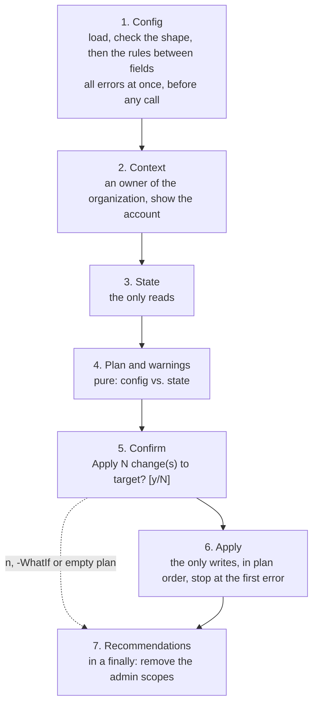

# Architecture

[Back to the overview](../README.md)

How the code of the engine is put together: the pipeline a run goes through, where each step lives, what the steps hand to each other, and how the tests replace GitHub. How to run it is in the [README](../README.md) and the [engine reference](../engine/README.md), how to change the code in [CONTRIBUTING](../CONTRIBUTING.md). This file is updated in the same change as the code it describes.

## Entry points

- `engine/bootstrap.ps1` is thin. It imports `shared/Bootstrap.Common.psm1`, then the module through its manifest `engine/GitHubOrg.psd1` (the release in `ModuleVersion`, equal to the latest release of `CHANGELOG.md`, a test checks it), and calls `Invoke-GitHubOrgBootstrap`, which prints the name and version of the engine first and which runs the gh check (`Assert-GhVersion`) after the config step, so a config it cannot read stops the run before any gh call. `engine/examples/run.ps1` is a copy for config repositories: it checks out the pinned engine and runs this script.
- `build.ps1` is the developer entry point: the checks of `ci.yml` and the scripts of `tools/`, listed in `build.psd1` (see [CONTRIBUTING](../CONTRIBUTING.md#checks)).

## The pipeline of a run

A run goes through these steps in order. Only the steps marked as reads and writes call GitHub; everything between them is pure and is where the decisions are made.

1. **Config**: `Import-BootstrapConfig -Validate { Test-GitHubOrgConfig }` reads the JSON file. `Test-GitHubOrgConfig` runs `Test-ConfigShape` against the engine's shape first, and its own rules between fields only on a valid shape (see [Config shapes](#config-shapes)). With `-ValidateOnly`, the engine stops after this step: it prints that the config is valid, its recommendation warnings and exceptions in force, and makes no gh call, the gh version check included.
2. **Context**: `Assert-GitHubOrgContext` checks that the `gh` account is an active owner of the organization with the scopes the run needs.
3. **State**: `Get-GitHubOrgState` reads what exists into plain hashtables. Every read is preceded by `Write-StateProgress`.
4. **Plan and warnings**: `Get-GitHubOrgPlan` diffs config and state into an ordered list of actions; `Get-GitHubOrgWarning` reports what differs and the engine does not change. `Write-BootstrapPlan` prints the plan, then the warnings and the exceptions in force (`Write-BootstrapWaiver`). the engine then prints one line about its `manual` rows (`Get-ManualSummary`, nothing without such rows) and, with `-ManualChecklist`, the checklist of them by page (`Get-ManualChecklist`), and with `-PageWalk` the settings pages one at a time (`Get-SettingPageWalk`, printed and stopped at by `Invoke-SettingPageWalk`), before the confirmation, so also with `-WhatIf`, an empty plan and `-Force`; all through `Write-Host`. The walk makes no API call: it shows the state, the plan and the tagged warnings (`Get-GitHubOrgWarningItem`) of the run.
5. **Confirm**: `Confirm-BootstrapPlan` asks once, after the plan. It does not ask for an empty plan, with `-Force`, or with `-WhatIf` (which stops here).
6. **Apply**: `Invoke-GitHubOrgPlan` runs the actions in order, `Write-ApplyProgress` before each, and stops at the first error. `Write-BootstrapSummary` prints what changed.
7. **Recommendations**: in a `finally` once the context check passed, so also after an error or an answer of `n`: `Write-ScopeRemoveRecommendation` prints the command that removes the admin scopes. Something the operator should do after a run is a recommendation (`Write-BootstrapRecommendation`), not a warning.

`Complete-BootstrapProgress` runs in a `finally` around the reads and the writes, so the progress bar also goes away on an error.

## Where each step lives

The engine module (`engine/GitHubOrg.psm1`) holds only the pipeline function and its `Export-ModuleMember` line. The steps are files in `engine/src/`, dot-sourced into the module, each with a `tests/<File>.Tests.ps1`.

| Step | File and function |
| --- | --- |
| Pipeline | `GitHubOrg.psm1`: `Invoke-GitHubOrgBootstrap` |
| 1. Config | `src/Config.ps1`: `Test-GitHubOrgConfig`, `Get-WorkflowReviewerReport`; `src/Config.Inventory.ps1`, `src/Config.Budget.ps1`, `src/Config.CopilotSeat.ps1` |
| 2. Context | `src/State.ps1`: `Assert-GitHubOrgContext` |
| 3. State | `src/State.ps1`: `Get-GitHubOrgState`; `src/State.Budget.ps1`, `src/State.CodeSecurity.ps1`, `src/State.CopilotSeat.ps1`, `src/State.Inventory.ps1`, `src/State.Ruleset.ps1` |
| 4. Plan | `src/Plan.ps1`: `Get-GitHubOrgPlan`, `Get-GitHubOrgWarning` (the text of `Get-GitHubOrgWarningItem`, whose items carry the settings page and row of each warning), `Get-ManualSummary`, `Get-ManualChecklist`; `src/Plan.Page.ps1`: `Get-SettingPageWalk` and its `Format-SettingPageWalk*` lines (`-PageWalk`); `src/Plan.Budget.ps1`, `src/Plan.CodeSecurity.ps1`, `src/Plan.CopilotSeat.ps1`, `src/Plan.Inventory.ps1`, `src/Plan.Ruleset.ps1` |
| 6. Apply | `src/Apply.ps1`: `Invoke-GitHubOrgPlan` |

Steps 5 and 7 are shared. The rules that keep this layout:

- GitHub reads only in `src/State*.ps1`, writes only in `src/Apply.ps1`; `src/Config*.ps1` and `src/Plan*.ps1` call neither. A new function goes into the file of the step it belongs to.
- Inside a step, each kind of object is a function of its own, for example `Get-RulesetAction` in `src/Plan.Ruleset.ps1` and `Get-CodeSecurityAction` in `src/Plan.CodeSecurity.ps1`.
- A step file that holds several areas is split by area into `src/<Step>.<Area>.ps1`; `<Step>.ps1` keeps the pipeline entry point, what the areas share and the area that is not split out. the engine has four areas: the settings (rows of `$script:SettingDefinitions`, one action per endpoint section) in `Config.ps1`, `State.ps1` and `Plan.ps1` (`Config.Catalog.ps1` holds `$script:SettingPages`, the settings pages of the organization in menu order, each `managed`, `unmanaged` with a reason, or `pending`, and loads `$script:ApiCatalog` from `engine/api-endpoints.psd1`, see [The endpoint catalog](#the-endpoint-catalog)); `Inventory` (read and warn only); and `CodeSecurity` and `Ruleset`, objects with a lifecycle. Such an object is one area: its config fields are rows of `$script:SettingDefinitions` under a section of its own; `State.<Area>.ps1` reads it by name; `Plan.<Area>.ps1` makes its actions (create, update, default, attach, where an endpoint carries the id the create response fills in) and its warnings; the shared `Invoke-GitHubOrgPlan` applies them. `Ruleset` is the organization ruleset: its config fields are rows under the sections `ruleset`, `ruleset.bypass`, `ruleset.rules`, `ruleset.rules.pullRequest` and `ruleset.rules.copilotCodeReview` (its `enabled` decides whether the rule is sent); `Get-RulesetBody` builds the one request body for create and update, `Compare-RulesetBody` lists the fields that differ, and `Get-UnmodeledRulesetField` the conditions, condition fields and rule parameters GitHub has that the body does not carry: warnings, never a change.
- The `src/` files are dot-sourced, not imported, so they share the module's scope, the scope that Pester's `Mock -ModuleName GitHubOrg` replaces commands in. They do not run on their own.
- The engine module does not import `Bootstrap.Common.psm1` itself: the caller (`bootstrap.ps1`, a test) imports it first. A nested import would create a second instance of the module, and mocks with `-ModuleName Bootstrap.Common` would miss it.

### Shared code

`shared/Bootstrap.Common.psm1` holds what is not specific to GitHub organization settings. The module itself keeps only the pinned GitHub REST API version (`$script:GitHubApiVersion`, read by path by the weekly scripts in `tools/`), the version row format and the exports; the functions live in `shared/src/`, one file per area, dot-sourced like the engine's `src/` files, so `-ModuleName Bootstrap.Common` mocks reach them. Their tests are `shared/tests/<File>.Tests.ps1`.

| File | Functions |
| --- | --- |
| `Config.ps1` | `Import-BootstrapConfig` |
| `ConfigShape.ps1` | `Test-ConfigShape`, `ConvertTo-ConfigSchema`, `Get-RecommendationReport`, `Get-ExceptionShape`, `Test-ExceptionList`, `Get-ItemExceptionReport`, `Get-RuleExceptionReport` (the exception of a rule of the engine on a field marked `RuleExceptions`), `Get-ConfigPattern`, `Get-ConfigPatternNode` (a shared pattern with its rule text), `Test-IsGuid` |
| `Output.ps1` | `Write-StateProgress`, `Write-ApplyProgress`, `Complete-BootstrapProgress`, `Write-BootstrapPlan`, `Write-BootstrapSummary`, `Write-BootstrapWaiver`, `Write-BootstrapRecommendation`, `Confirm-BootstrapPlan` |
| `GitHub.ps1` | `Assert-GhVersion`; `Invoke-GhApi`: the only way the engine calls the GitHub REST API, with the pinned API version; sends a request body as JSON of depth 10; enumerates a JSON array root unless `-NoEnumerate` (the root as it is: the section and check-only reads of the engine, so a single-item array is not taken for an object); its errors carry the HTTP status, which callers check with `Test-GhStatus` or read with `Get-GhStatus` (`$null` without an answer; also behind an error that wraps one), never the message text |

## Config shapes

The config is described once, by its shape: `Get-GitHubOrgConfigShape` in `src/Config.ps1`. In the engine the shape is built from the rows of `$script:SettingDefinitions` (one row per GitHub setting) and `$script:Sections` (one per endpoint), so supporting a new setting is a new row. A row also carries keys the shape ignores: `Page` (a path of `$script:SettingPages`; `NoUi = $true` with `Page = $null` for a field no page shows), `UiGroup`, `UiLabel`, `Hint`, `Options` (value -> the option label of the page, for an enum without a checkbox: the check warning says which to choose), `Read` and `Write` (`@{ Endpoint; Field }` and `@{ Method; Endpoint }` with OpenAPI paths such as `/orgs/{org}/actions/permissions`; for a row of a section of `$script:Sections` they default to that section's endpoint, method and the field name, through `Get-SettingRead` and `Get-SettingWrite`), `Docs`, `PlanRestriction`, `ReadRequiresPlan`, `Absent`, `AbsentValue` (the value of a field an object answer leaves out when nothing is set, such as `none` for interaction limits, which GitHub answers with `{}`), `DependsOn` (a boolean `apply` field of the same section: while the config sets it to `false`, GitHub ignores this field and keeps its value, so the plan does not compare it, a PUT sends back what GitHub has and the page walk marks it `[n/a]`, all through `Get-InactiveDependency`; `actions.privateForkPullRequests.require_approval_for_fork_pr_workflows`). `Read.Field` may be a dotted path (`default_review_effort.configured`) into an object of the answer; the unknown-field check takes its first part. The keys a row may have are `$script:SettingRowKeys` (a test rejects any other, so a misspelled key is not ignored). The top-level sections, in the order of `github.json`, are `$script:TopLevelSections`, starting with `configVersion` (`major.minor`): `Test-GitHubOrgConfig` accepts the major of `$script:ConfigFormatVersion` up to its minor and returns only that error otherwise, before the shape check (a config of another format differs in its keys, and those errors would hide this one); a missing or malformed version is a shape error; a section by page or subject (`copilot.policies`, `memberPrivileges`, `personalAccessTokens`, `advancedSecurity` ...) is in the shape once a row is in it. Sections come in three kinds: a section of `$script:Sections` is one endpoint and one plan action, and every row in it reads that endpoint, never a `manual` row (a test in `tests/Config.Catalog.Tests.ps1`); a section by page or subject holds `check` rows with a `Read` of their own and `manual` rows, of any endpoints, since `check` rows are read grouped by `Read.Endpoint`, not by section; the areas `codeSecurity*` and `ruleset*` are read and written by their area's code. A row keeps its path from `manual` to `check` and moves into the section of its endpoint from `check` to `apply`. `NoRecommendation` (`Project data: ...` or `Owner decides: ...`) says why a row has no `Recommended`; a catalog test requires one of the two, and the shape node gets it after its `Description`, so the schema shows it. `Sensitive` also goes to the row's shape node (a shape node key, which the schema leaves out): `Get-RecommendationReport` names such a field without its value or the recommended one. `Mode` is `apply`, `check` or `manual` (no API read, never default-read; `ConvertTo-FieldMap` leaves it out of the state).

A shape is a tree of hashtable nodes: `Type`, `Fields` (objects), `Items` (arrays), `Pattern`, `Rule`, `Values`, `Nullable`, `Unique`, `Minimum`, `Maximum`, `RuleExceptions` (the field takes exceptions for a rule the engine applies to it, `Get-RuleExceptionReport`), `Description`, `Recommended` and `Why`, and a few more (`$script:ShapeNodeKeys` in `shared/src/ConfigShape.ps1`). An unknown key or type is an error, so a misspelled key cannot switch a check off. From the shape come:

- **Validation**: `Test-ConfigShape` checks types, required and unknown keys, patterns and uniqueness, and collects every error before the run touches GitHub.
- **Recommendations**: `Get-RecommendationReport` warns about a value that differs from `Recommended` unless an exception in force in the config's `exceptions` covers it; exceptions in force are printed on every run.
- **The JSON Schema**: `./tools/Build-ConfigSchema.ps1` writes `<config>.schema.json` (editor completion and hover); a test fails while a schema is stale.
- **The settings reference**: `./tools/Build-SettingReference.ps1` writes `engine/settings.md` from `Get-GitHubOrgSettingReference` (`Config.Catalog.ps1`): every settings page with its rows and `Unmanaged` entries (UI coverage), and every catalog endpoint with the fields a row reads or the catalog leaves unmanaged (API coverage), the two never added up; a test fails while the file is stale.

## Contracts between the steps

State and actions are the interface between the steps; tests and config repositories rely on them, so they stay stable. Every action has a `Target` and a human-readable `Summary`; state hashtables are case-insensitive. Section actions of the engine also carry `Details` (`[string[]]`: the web UI page, the read endpoint and the write of the changed fields), which `Write-BootstrapPlan` prints under the summary; an action without `Details` prints as before.

### the engine

| State | Content |
| --- | --- |
| `Settings`, `Actions`, `SelectedActions`, `Workflow`, `SelfHostedRunners`, `ForkPullRequests`, `PrivateForkPullRequests`, `Retention`, `CopilotCloudAgent` | field → value of the supported fields of each section; `SelectedActions` is `$null` unless `allowed_actions` is `selected` |
| `Inventory` | `{Owners, Apps, Webhooks, OutsideCollaborators, Invitations, RepositoryInvitations, SkippedRepositories}`: only ever warnings |
| `CodeSecurity` | `{Configuration, Default, OtherDefaults, Repositories, SkippedRepositories}` |
| `Budgets` | `{Id, Type, Sku, Scope, Amount, PreventFurtherUsage, WillAlert, Recipients}` of every budget; compared by scope, type and product |
| `Observations`, `CheckedValues`, `OrganizationPlan`, `ResponseFields`, `ReadAt` | `ReadAt`: the UTC time (`[datetime]::UtcNow`) when the last read of `Get-GitHubOrgState` returned, set once at its end; only the page walk prints it. `Observations`: config path (`<section>.<field>`) → `{Status, ReasonCode, HttpStatus, Source, Reason}` for every `check` row the run did not observe (`NotObserved`: `FieldMissing`, `AuthenticationFailed`, `PermissionDenied`, `NotFound`, `PlanRestricted`, `TechnicalFailure`; `NotApplicable`: `FeatureAbsent`); a row without an entry was observed, and a state built without the key means everything observed. `CheckedValues`: config path → value of a `check` row outside `$script:Sections`, from whichever read reaches its endpoint, a section endpoint included; `Get-GitHubOrgWarning` compares it with the config after the rows of `$script:Sections`, and a check row with a `Write` says the engine does not apply it yet instead of that GitHub has no API. `OrganizationPlan`: `plan.name` of `GET orgs/{org}` or `$null`. `ResponseFields`: endpoint (OpenAPI path, `/orgs/{org}`) → the top-level field names of its answer, never values, only for an answer that is an object. A read that an `apply` row depends on (`$script:ApplyReadEndpoints`) still stops the run when it fails; an endpoint only `check` rows read does not |
| `CopilotSeats` | `{PlanType, SeatManagement, Total, Seats, Teams}` from `copilot/billing`, read once per run: `{Login, Team, PendingCancellation}` of every seat, and slug → logins of each team of the config (`$null`: no such team); `$null`: no plan, which GitHub answers with 404 or with seat management `unconfigured`. `Read-CopilotBilling` reads it before the check-only endpoints: its `check` rows get `CheckedValues` or a `FieldMissing` observation, and without a plan every row with `Absent = 'CopilotPlan'` is `NotApplicable` without a read of its endpoint (a status case of `$script:AbsentCases` counts only on the case's own endpoint) |
| `Ruleset` | `{Current, OtherRulesets, Teams, WorkflowSources, RepositoryVisibilities, References, Copilot}`: the matched organization ruleset as GitHub returns it or `$null`; `{Id, Name, Target, Enforcement}` of every other one; reviewer team slug → `{Id, Slug, HasRepositoryWrite}` (`$null`: no such team); `"<repository>/<path>@<sha>"` → `{RepositoryId, Visibility, AccessLevel, Content}` (`$null`: no such repository, `Content` `$null`: no file at that commit); the visibilities of the non-archived repositories; file name → text of the reference copy of each required workflow, the file of that name in the directory of the config (`Get-GitHubOrgState -ConfigDirectory`, which `Invoke-GitHubOrgBootstrap` passes; none without a directory or a file); `{PlanType, Seats}` of the Copilot plan, taken from `CopilotSeats` (`$null`: no plan, or `copilotCodeReview.enabled` is `false`) |

Actions, in this order: `UpdateOrganizationSettings` (PATCH, only the fields that differ), then one PUT per section with the full body (`SetActionsPermissions`, `SetSelectedActions`, `SetWorkflowPermissions`, `SetSelfHostedRunners`, `SetForkPullRequestApproval`, `SetPrivateForkPullRequestWorkflows`, `SetArtifactAndLogRetention`, `SetCopilotCloudAgentAccess`), then `CreateCodeSecurityConfiguration`, `UpdateCodeSecurityConfiguration`, `SetCodeSecurityDefault` and `AttachCodeSecurityConfiguration`, then `CreateRuleset` (POST) or `UpdateRuleset` (PUT, the whole ruleset), never both, then `CreateBudget` (POST) or `UpdateBudget` (PATCH, only what differs) per budget, then `AddCopilotSeats` (POST, every login without a seat) and `AddCopilotTeam` (POST, per team with a member without a seat), only while seat management is `assign_selected`. Each carries `Method`, `Endpoint` and `Body`. Settings in mode `check` only ever produce warnings.

The full field lists are in the code: `Get-GitHubOrgState` builds the state, and the engine reference describes what the actions do in GitHub.

#### The endpoint catalog

`engine/api-endpoints.psd1` (a data file, so `tools/` and the tests read it without importing the engine; `$script:ApiCatalog` in the module) lists every operation, every method of every path, under `/orgs/{org}` and `/organizations/{org}` of the OpenAPI description of the pinned REST API version (`ApiVersion`, which a test keeps equal to `$script:GitHubApiVersion`; `ReviewedOn`), and every operation outside them that the engine calls (`/user/memberships/orgs/{org}`, `/repos/{owner}/{repo}/...`). `Paths`: path → `Category` (the description's `x-github.category`) and method → `@{ Status; Reason; Fields; Body }`. `Status` is `read` (the engine calls this GET), `write` (`Apply` calls this method) or `unused` with its `Reason`; coverage is per operation, so `GET /orgs/{org}` is `read`, `PATCH` `write` and `DELETE` `unused`. Tests in `tests/Config.Catalog.Tests.ps1` record every gh call of the round trip scenarios on the fake and check both directions: each call has its status, and each `read` or `write` operation is called.

Two field lists, for two different checks, never merged:

- `Fields`, on a `read` GET: every response field of the description that no row reads, with the reason (`Get-UnmanagedField`). In step 1 exactly the GETs of the endpoints of `$script:Sections` have it. `Get-UnknownResponseField -State` (pure) scans `ResponseFields` for the GETs the run called that are `read` with `Fields`: a name that is neither a row's `Read.Field` for that endpoint nor in `Fields` is unknown, and `Get-GitHubOrgWarning` warns once per endpoint, after the not-observed warnings, naming the fields, never their values. A section sent with a PUT (`$script:Sections` with `Method` `PUT`) whose endpoint has an unknown field is skipped by `Get-GitHubOrgPlan` (a PUT replaces the whole section and could reset the field), and its warning says so instead of the generic one; the allowed-actions selection is skipped with it unless GitHub already has allowed_actions `selected` (`Get-SkippedPutSection`; GitHub answers 409 otherwise); the PATCH of the organization settings is unaffected. List endpoints and the area reads (code security, ruleset, budgets, Copilot seats) have no `Fields` and are not scanned; the ruleset keeps `Get-UnmodeledRulesetField`.
- `Body`, on a `write` PUT or PATCH: every request body field of the description, managed or not, never read at run time. For a PUT section it equals the section's `apply` fields, the section has no other rows, and every PUT the round trip sends carries exactly those fields (a PUT replaces the section); a PATCH, and an area PUT such as `UpdateRuleset`, sends only fields of its `Body`.

The weekly check `tools/Invoke-ApiEndpointCheck.ps1` (`recurring.yml`, job `api-endpoints`) keeps the catalog in line with the description, offline from the organization: it reads `api-endpoints.psd1` directly, downloads the description of the pinned version and opens an issue (label `api-endpoint`) for an operation that is new under the two prefixes, listed and no longer described, or a `write` PUT or PATCH whose request body fields (`$ref` and `allOf` resolved; a `$ref` that does not resolve throws) differ from `Body`. The body holds the marker of the operation (`<!-- api-endpoint: <METHOD> <path> -->`) and of the difference (`<!-- api-endpoint-difference: <signature> -->`, the kind or `request body fields: +new -gone`): a difference that no issue of its operation records opens a new issue once none of the operation is open, and an issue opened by hand without the second marker covers every difference of its operation. A body that is not JSON or has a `oneOf`/`anyOf` is reported as not comparable, never an issue. It gathers and sanity-checks everything first and writes last, so incomplete data never opens an issue. `-Version <new> -Report` is the review of a raise of `$script:GitHubApiVersion`: it opens nothing and also prints the response fields of each `read` GET with `Fields` that the description has and neither a row nor `Fields` lists, the only time it imports the engine (`-StageModulePath`, `engine/GitHubOrg.psm1` by default, a fake one in its tests; `Get-GitHubOrgReadField`, the fields the rows read by endpoint, which `Get-UnknownResponseField` uses too). A response field difference is never an issue: the run's unknown-field warning covers real answers, and neither check reads the other's output.

## Case in comparisons

The rule: a value compares the way the system that owns it compares it. Names and ids that GitHub treats as the same whatever their case compare case-insensitively (`-eq`, `-in`, hashtable keys, `OrdinalIgnoreCase`), so a config spelled differently from the portal does not plan a change. Everything else compares exactly (`-ceq`, `-cin`, `Ordinal`): a value that is matched exactly somewhere (a token subject), a value the engine writes as it is (a display name, a description), and the config's own keys and paths. A new value goes into the table with its reason, and its code comment names only what differs from the rule.

| Value | Comparison | Why |
| --- | --- | --- |
| GitHub logins (owners, outside collaborators), App slugs, App permission names, webhook hosts, `patterns_allowed` of selected actions | case-insensitive | GitHub logins and slugs are case-insensitive, DNS names too; lists compare as sets |
| Email settings of the engine | case-insensitive | email addresses |
| Other settings of the engine, App repository selection and permission levels | exact | enum values of the GitHub API and values the engine writes as they are |
| Code security configuration name | exact; one that differs only in case is an error | GitHub keeps names unique whatever their case, and an update never renames one |
| Code security description, enforcement, settings, default for new repositories, attachment status | exact | the engine writes them as they are, or they are enum values of the API |
| Ruleset name | exact; one that differs only in case is an error | GitHub keeps organization ruleset names unique whatever their case, and an update never renames one |
| Reviewer team slugs of the ruleset | case-insensitive | GitHub team slugs are case-insensitive; the engine reads the team by its lower-case slug |
| Ruleset merge methods, file patterns, workflow paths and SHAs, conditions | exact (lists compare as sets) | GitHub matches paths and patterns exactly, and the engine writes the rest as it is |
| Workflow content against the file of the same name beside the config (only when there is one) | exact, line endings and final newlines ignored | git and editors change them, GitHub runs the same file |
| Bypass actors of the ruleset | by `actor_type` and `bypass_mode`; `actor_id` ignored for `OrganizationAdmin` and `DeployKey` | GitHub ignores the id for these types and may answer a number |
| Config keys, enum values, patterns, `exceptions` field paths and their list items | exact | `organisation` must not pass for `organization`; JSON Schema compares strings exactly too, so the editor and the run agree |
| Items of an array marked `Unique` | case-insensitive | they hold the case-insensitive names above; the schema can only reject exact repeats |

## Tests

The tests never call GitHub; CI runs them on Ubuntu without credentials.

| Replaces | How | Where |
| --- | --- | --- |
| `gh`, one answer per call | `Register-TestGhStub`: a PowerShell function in place of `gh`; its responder gets the arguments, the request body and the headers. `Register-TestGhRoute` answers by `<METHOD> <endpoint>` | `shared/tests/GhStub.ps1` |
| The GitHub API, with state | `Register-TestGhFake`: a store behind the stub, so a write changes a later read. The round trip of the engine applies a plan to it and checks that the next plan is empty | `shared/tests/GhFake.ps1`, `engine/tests/RoundTrip.Tests.ps1` |
| A real `gh` executable | `Register-TestNativeGh`: a `gh` first on `PATH` that runs `FakeGh.ps1` and answers from a routes file. For what the stub skips: output decoding, stderr, stdin, exit codes. Each call starts a pwsh, so these tests stay few | `shared/tests/NativeGh.ps1` |
| Installed modules | `Add-TestModule` writes real modules on disk, for the tests of module loading | `shared/tests/TestModule.ps1`, `tools/tests/DevModule.Tests.ps1` |

The engine has its fixtures in `engine/tests/TestData.ps1`: a config, a state that matches it, and builders for single objects. Apply tests take their actions from the engine's `Get-GitHubOrgPlan`, not from hand-built objects. What a shared helper does is tested in `shared/tests`; an engine test checks only that the engine uses it.

`tools/` holds standalone scripts (no module); `tools/tests/` runs each one with its external commands mocked. Neither they nor the `bootstrap.ps1` files count towards the coverage, which measures `shared/` and the engine modules.
